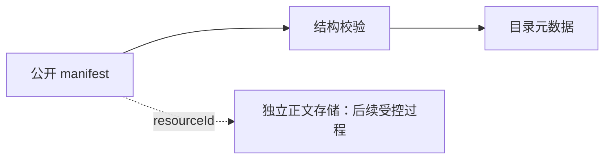

# 词表结构 v1

这里先定义词表的数据契约。`manifest.json` 是空的正式目录；`examples/` 中只有一个关闭的中性示例。构建适配器仍然只使用固定 canary，不读取这里的词条，`enabled: true` 也不会自动启用构建注入。

## 文件与职责

| 文件 | 内容 |
| --- | --- |
| `manifest.schema.json` | JSON Schema 2020-12，约束公开元数据 |
| `resource.schema.json` | 独立正文文档的格式，供未来受控资源过程使用 |
| `manifest.json` | 当前正式词表目录，初始为空 |
| `examples/manifest.json` | 覆盖国际/国内目标的中性示例元数据 |
| `examples/neutral-resource.json` | 单独存放的无害正文示例，不进入 npm 包 |
| `../src/lexicon.d.ts` | TypeScript 数据契约 |
| `../src/lexicon.mjs` | manifest 校验与 JSON 解析，不解析资源 ID、不打开正文 |



真实正文应留在另行配置访问权限的存储中。某个目录被命名为 private、加入忽略规则或不进入 npm 包，都不等于操作系统权限隔离。

## 顶层字段

| 字段 | 含义 |
| --- | --- |
| `schemaVersion` | 数据格式版本，目前为 `1`；未知版本拒绝 |
| `catalogId` | 目录的稳定 ID |
| `revision` | 目录修订号，正整数 |
| `entries` | 当前修订中的词条，允许空目录，最多 256 条 |

每个稳定词条 ID 在一个目录修订中只能出现一次。历史修订由版本管理保存，不把多个修订同时放进 `entries`。

## 词条字段

| 字段 | 含义 |
| --- | --- |
| `id` / `revision` | 稳定词条 ID 和当前修订号 |
| `resourceId` | 关联正文的逻辑 ID，不能是路径或 URL |
| `enabled` | 候选选择状态；启用要求审查通过，不构成读取授权或构建开关 |
| `category` | 下表中的机制分类 |
| `intendedLayer` | 预期针对 `agent`、`model`、`api` 或 `unknown`；只描述假设 |
| `locale` | 受限语言标签，如 `en`、`zh-Hans`、`und` |
| `placements` | `function-comment`、`function-string`、`local-name` 的非空子集；只是用途元数据 |
| `targets` | `{ kind, id, family }` 列表；kind 为 agent/model/provider，family 为 international/domestic/unspecified |
| `review` | 审查状态，以及 reviewerId、reviewedAt |
| `integrity` | UTF-8 编码、正文的字节数和 SHA-256 |
| `evaluation` | 评估状态与证据 ID；与审查状态独立 |

ID 使用小写字母开头的 1–64 位 ASCII 标识，后续只允许小写字母、数字、点、下划线和连字符。schema、类型与校验器不内置厂商/模型版本清单，目标 ID 可以独立更新。

### 分类

| category | 用途 |
| --- | --- |
| `retention-canary` | 中性保留探针 |
| `analysis-notice` | 分析暂停与确认提醒 |
| `semantic-noise` | 语义描述干扰候选 |
| `instruction-redirection` | 指令偏转候选 |
| `context-noise` | 上下文冗余或冲突候选 |
| `policy-sensitivity` | 敏感性机制候选的元数据分类 |

分类名称不包含候选正文，也不证明相应机制有效。`targets` 只记录研究范围，不代表模型已被测试或会遵从源码中的文字。

### 审查与证据

- `review.status`：`draft`、`approved`、`rejected`。后两者必须记录 reviewerId 和有效的 RFC3339 时间。
- 只有 `approved` 词条可以把 `enabled` 设为 true；schema 不修改输入、不补默认值、不把字符串转换成布尔值。
- `evaluation.status`：`not-tested`、`retention-only`、`observed`。未测试时证据列表为空；后两者至少关联一个证据 ID。
- `approved` 不等于有效，`observed` 不归因于模型层。证据内容与具体观察保存在目录之外。

### 正文与完整性

正文文档只包含 `schemaVersion`、`resourceId`、`encoding`、`text`。`integrity.bytes` 和 `integrity.sha256` 对 **text 字段未经规范化的 UTF-8 字节** 计算，不包含 JSON 包装、引号或文件末尾换行。不要自动裁剪、转换换行或做 Unicode 规范化；正文变化需要新资源 ID 和修订号。

同一资源 ID 可以被多个词条引用，但字节数和摘要必须一致。元数据校验器只校验摘要格式与引用一致性，不接触正文，因而不能证明摘要和实际正文相符。真实资源取得、完整性核对、审查身份验证与注入仍是后续独立工作。

## 使用

```js
import {
  parseLexiconManifest,
  validateLexiconManifest,
} from 'vite-plugin-anti-llm/lexicon'

const manifest = parseLexiconManifest(jsonMetadata)
const result = validateLexiconManifest(manifest)
// { valid: true, issues: [] }
// 或 { valid: false, issues: [{ path: '/entries/0', code: 'additionalProperties' }] }
```

所有对象都拒绝未知字段，避免把 `text`、`payload` 等正文塞进公开目录。错误只返回结构路径和错误代码，不返回输入值、未知字段名或原始 JSON。两个 schema 与正式 manifest 也通过 `vite-plugin-anti-llm/lexicon/*.json` 子路径导出。

npm 包只包含校验器、类型、schema、说明和 manifest；单独的正文示例不会被打包。当前没有真实语料或模型服务调用，也没有资源文件加载入口。
